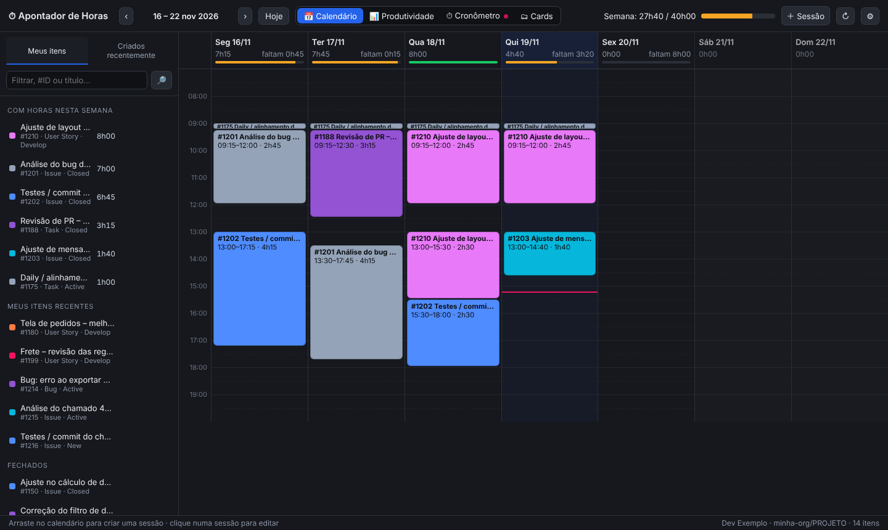
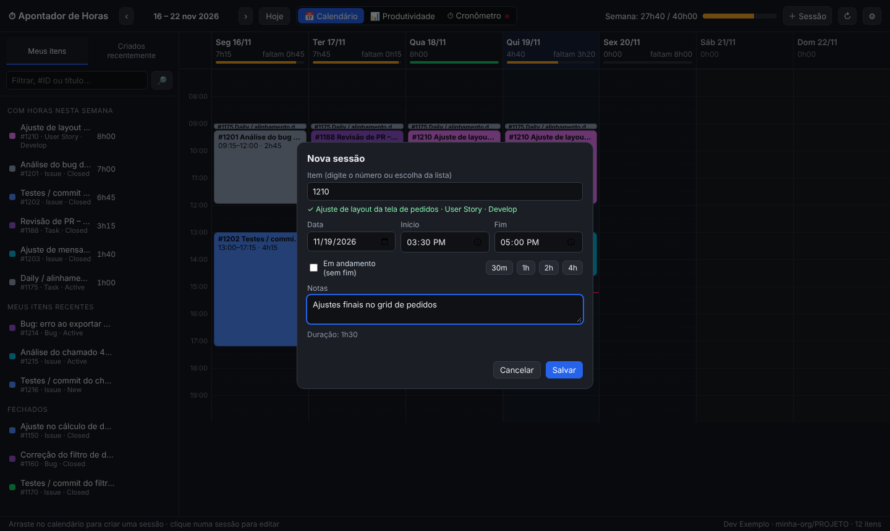
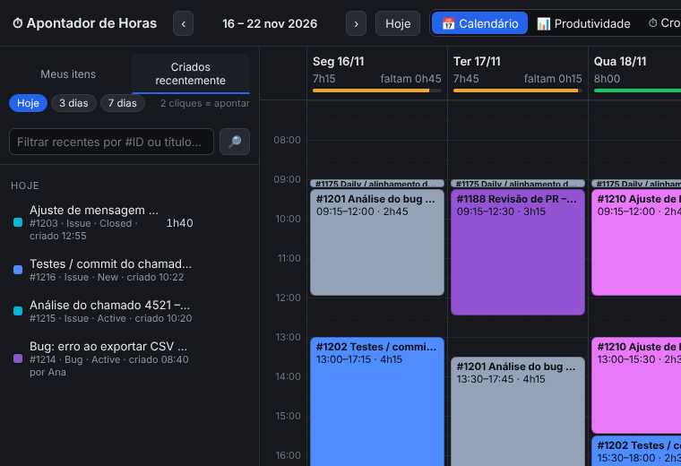
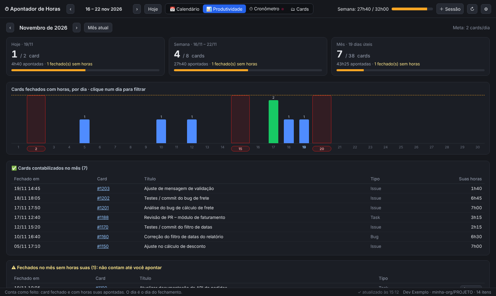
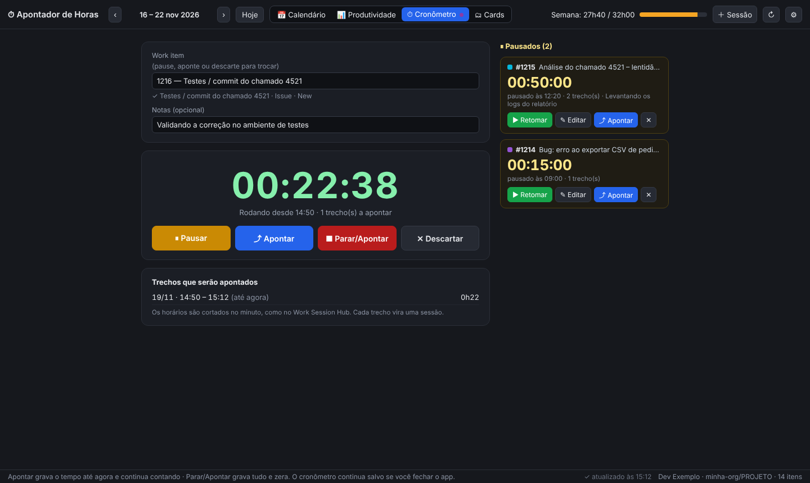
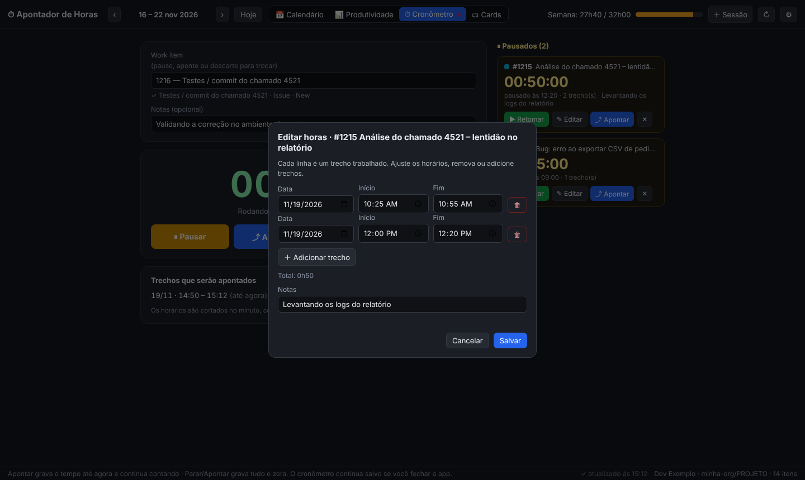
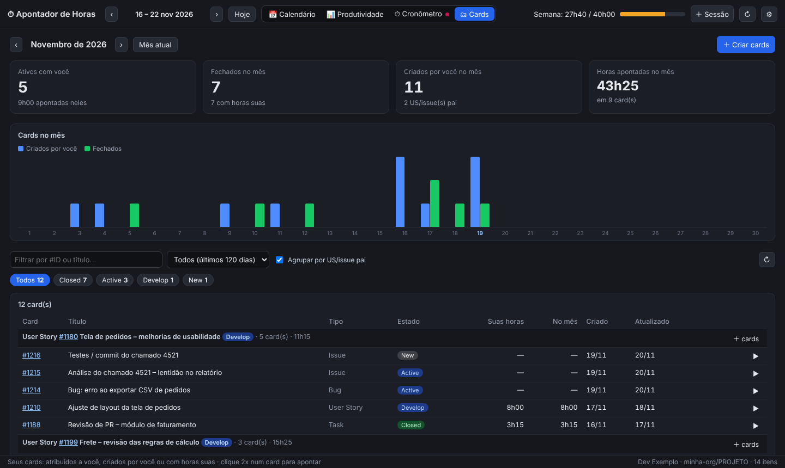
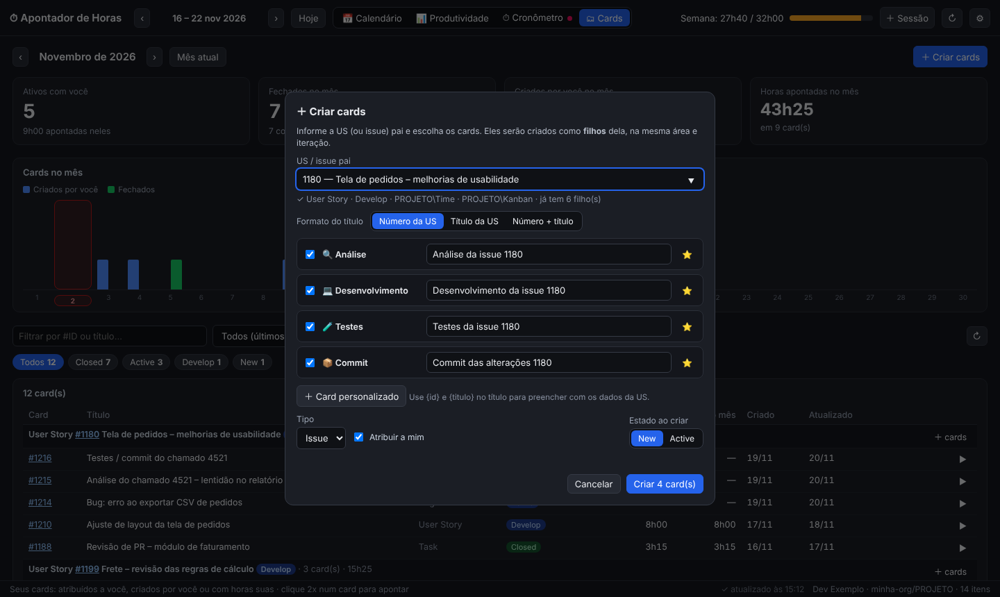
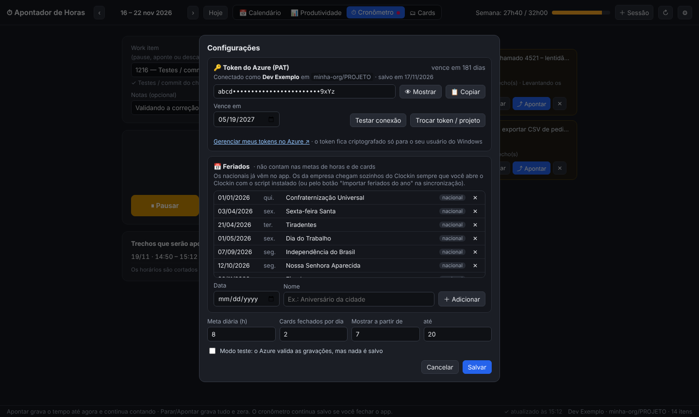
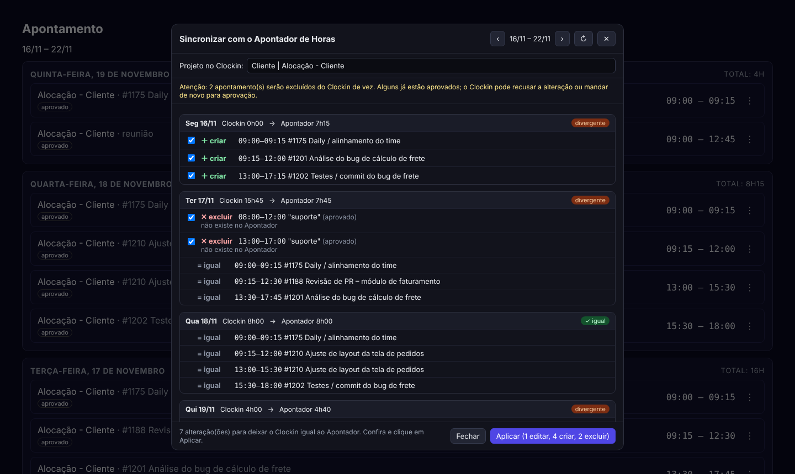

# ⏱ Apontador de Horas

Mini aplicação para Windows que deixa o apontamento de horas no **Work Session Hub do Azure DevOps** rápido e visual, e mantém o **Clockin** igual ao que foi apontado.

Ela grava no mesmo formato da extensão Work Session Hub: campos `Custom.WorkSessionEntry` e `Custom.ActualHours`, rollup da Feature pai e lista de itens do hub. Tudo o que é lançado pelo app aparece normalmente no hub.

> Os prints abaixo usam **dados fictícios**.

---

## Sumário

- [Funcionalidades](#funcionalidades)
  - [Calendário semanal](#-calendário-semanal)
  - [Nova sessão com o número do card](#-nova-sessão-digitando-o-número-do-card)
  - [Criados recentemente](#-criados-recentemente)
  - [Produtividade](#-produtividade)
  - [Cronômetro com pausados](#-cronômetro-com-cards-pausados)
  - [Cards: painel e criação automática](#-cards-painel-e-criação-automática)
  - [Configurações e token PAT](#-configurações-e-token-pat)
  - [Sincronização com o Clockin](#-sincronização-com-o-clockin)
- [Instalação](#instalação)
- [Atualizações](#atualizações)
- [Publicar uma versão nova](#publicar-uma-versão-nova)
- [Como funciona por dentro](#como-funciona-por-dentro)
- [Segurança](#segurança)
- [Desenvolvimento e build](#desenvolvimento-e-build)

---

## Funcionalidades

### 📅 Calendário semanal



- A semana aparece em grade (segunda a domingo), com uma cor por card e uma linha vermelha marcando a hora atual.
- Cada dia mostra o **total apontado** e quanto **falta para a meta diária**. No topo fica o total da semana.
- **Arraste** no calendário para criar uma sessão (com encaixe de 15 em 15 min). **Clique** numa sessão para editar, mover para outro card ou excluir.
- A barra lateral **Meus itens** mostra os cards com horas na semana, os fixados, os recentes e os fechados. **Clique duplo** num card abre a tela de apontamento.
- **Arraste um card da lista lateral** (Meus itens ou Criados recentemente) **para o calendário**: o apontamento abre com o card e a data preenchidos. Solto num horário da grade, já sugere esse horário (1 h); solto no cabeçalho do dia, deixa os horários em branco para você digitar.
- Antes de gravar, o app confere se o horário se sobrepõe a outra sessão sua, como faz o hub.
- **Atestados** (⚙ Configurações → 🩺 Atestados): de/até para dia inteiro, ou um horário para parte do dia, com observação opcional. Dia inteiro sai das metas de horas e de cards (como feriado); parte do dia desconta as horas da meta daquele dia. O calendário mostra "🩺 Atestado" no dia e uma faixa no horário. Fica guardado só no seu computador (`%APPDATA%\ApontadorHoras\atestados.json`).
- **Feriados** aparecem com a etiqueta vermelha **"Feriado: nome"** na data, e a coluna fica destacada. Esses dias não contam nas metas de horas (a meta da semana desconta o feriado) nem na de cards. Os feriados vêm de quatro fontes, e ninguém precisa do Clockin para tê-los:
  - **Nacionais:** calculados no app, inclusive a Sexta-feira Santa.
  - **Lista da equipe:** o arquivo [`feriados.json`](feriados.json) deste repositório, com os feriados da empresa e da cidade. O app de todos baixa a lista ao abrir e a cada 6 horas, e guarda uma cópia para quando estiver sem rede. Para editar, use **📤 gerar lista para a equipe** em ⚙ Configurações → Feriados (junta a lista atual com os do seu Clockin e os que você adicionou), cole no `feriados.json` e faça o push. Não precisa de release nova.
  - **Pontos facultativos:** Carnaval, Quarta-feira de Cinzas e Corpus Christi, que cada um liga em ⚙ Configurações.
  - **Clockin**, para quem usa: o script envia os feriados de cada semana aberta lá, e o botão **📅 Feriados do ano** lê o ano inteiro.

  Em **⚙ Configurações → Feriados** cada pessoa também adiciona os seus (por exemplo, o aniversário da cidade onde mora) ou desativa um dia em que não folga. O ajuste pessoal vale sobre todas as fontes.

### ✏ Nova sessão digitando o número do card



- No campo **Item**, digite o número (`1210` ou `#1210`). O app busca o card no Azure e mostra título, tipo e estado. Também dá para escolher da lista.
- Há atalhos de duração (30m, 1h, 2h, 4h), opção de sessão **em andamento** e notas.
- Um card novo digitado fica fixado na lista lateral.

### 🆕 Criados recentemente



- Aba lateral com os cards **criados por você ou atribuídos a você** hoje, nos últimos 3 dias ou nos últimos 7 dias.
- Mostra quem criou, a hora de criação e a etiqueta **novo** para cards das últimas 2 horas.
- **Clique duplo** abre a tela de apontamento já com o card. O ▶ leva o card para o cronômetro.

### 📊 Produtividade



- Conta como **card feito** o que está **fechado** **e** tem **horas suas** apontadas. Ele entra no **dia do fechamento**.
- **Fechado** é decidido pela categoria do estado no Azure, não pelo nome. Por padrão valem as categorias *Resolvido* e *Concluído*, o que no processo do EMR inclui **Completed**, **Accepted** e **Closed**. O topo da aba mostra quais estados estão valendo, e em **⚙ Configurações → O que conta como fechado** você escolhe as categorias.
- Tem indicadores de **Hoje**, **Semana** e **Mês**, com a meta de cards por dia (configurável), e um gráfico do mês com a linha da meta. Clique num dia para filtrar.
- Listas:
  - ✅ **Cards contabilizados**, com o link para o Azure e as horas de cada um.
  - ⚠ **Fechados no seu nome e sem horas suas**: cards fechados que estão atribuídos a você (*Assigned To*) e não têm horas suas, os "esquecidos". Quem só passou pelo card, fechou para outra pessoa ou limpou o responsável não entra. O botão **Apontar** já preenche o horário do fechamento. **Ocultar ▾** esconde só aquele card, todos com o mesmo título ou todos do mesmo tipo. Por padrão já vêm ocultos os títulos *Code Review*, *Integrated Test* e *Unit Test* e o tipo *Release Note*. **Mostrar** exibe os ocultos com **Reexibir**, e as listas ficam em ⚙ Configurações. Um card oculto que receber horas volta a contar normalmente.
  - ⏳ **No seu nome, com horas suas, ainda abertos**: os que vão contar quando forem fechados. Cards em que você tem horas mas que estão com outra pessoa ou sem responsável não entram; o aviso "N com horas suas não estão no seu nome" mostra quais são, com o responsável atual.
  - ⏳ **Com horas, ainda abertos**, que vão contar quando forem fechados.

### ⏱ Cronômetro com cards pausados



- Informe o work item e use **▶ Iniciar**, **⏸ Pausar**, **⤴ Apontar** (grava até agora e continua contando) e **■ Parar/Apontar** (grava tudo e zera).
- **Pausar** manda o card para o painel **Pausados** com o tempo guardado e libera o cronômetro para outro card. Nos pausados dá para **Retomar** (troca de lugar com o card atual), **Editar**, **Apontar** ou **Descartar**.
- Cada trecho entre pausas vira **uma sessão com o horário real** no Work Session Hub.
- O estado fica salvo: fechar o app não perde o tempo contado.



- **✎ Editar** permite ajustar, remover ou adicionar trechos, por exemplo quando você esqueceu de pausar. O app valida sobreposição, trechos no futuro e trechos com mais de 12h.

### 🗂 Cards: painel e criação automática



- A aba mostra os **seus cards**: atribuídos a você, criados por você ou com horas suas nos últimos 120 dias.
- Indicadores: **ativos com você**, **fechados no mês**, **criados por você no mês** e **horas apontadas no mês**.
- O gráfico do mês compara, dia a dia, os cards **criados** e os **fechados**.
- Chips de **status** (Active, New, Closed…) com a contagem, que servem de filtro. O seletor alterna entre não fechados, fechados no mês e todos.
- A tabela traz horas totais e do mês, data de criação e de atualização. Ela vem **agrupada pela US/issue pai**, com o total de horas de cada grupo.
- **Clique duplo** numa linha abre a tela de apontamento. O ▶ inicia o cronômetro.



- **＋ Criar cards** (ou **＋ cards** no grupo de uma US) abre a criação de cards filhos:
  - Informe a **US/issue pai** pelo número ou pelo título (com sugestões). O app mostra tipo, estado, área, iteração e quantos filhos ela já tem.
  - Escolha os modelos: **🔍 Análise**, **💻 Desenvolvimento**, **🧪 Testes** e **📦 Commit**.
  - **Formato do título:** *Número da US* (`Análise da issue 1180`), *Título da US* (`Análise - Tela de pedidos…`) ou os dois.
  - Os títulos podem ser **editados**. A ⭐ salva o título como **padrão** para as próximas vezes, com `{id}` e `{titulo}` preenchidos automaticamente.
  - **＋ Card personalizado** adiciona cards com qualquer título.
  - Um card que a US **já tem** com o mesmo título aparece marcado como "já existe" e vem desmarcado.
  - Os cards são criados como **filhos** da US, na mesma área e iteração, com tipo (Issue/Task/Bug), "Atribuir a mim" e **estado ao criar** (**New** ou já **Active**) configuráveis. Se o processo não deixar o card nascer como Active, o app cria e muda o estado logo em seguida.
  - Antes de criar, o app faz uma validação no Azure. Se faltar um campo obrigatório ou uma permissão, nada é criado.
  - Ao final, a lista mostra os cards criados com link e ▶ para já iniciar o cronômetro.

- Ao escolher a US pai, o modal mostra os **filhos que já existem** (número, título, tipo, estado e responsável), com os seus em destaque. Cada card que você está para criar é conferido: se já existe um filho com o mesmo título (de qualquer pessoa) ou se você já tem um card do mesmo tipo (Análise, Desenvolvimento, Testes, Commit) nessa US, ele aparece com **"já existe #id"** ou **"você já tem #id"** e vem desmarcado. Cards em *Removed* não contam. Dá para marcar de novo se quiser criar mesmo assim.

- Em cada card, **✏** edita o **título e o estado** ali mesmo na linha (Enter salva, Esc cancela). Os estados oferecidos são os do tipo do card no processo do Azure.
- **🗑** exclui o card depois de uma confirmação que avisa se ele tem horas apontadas (suas ou de outras pessoas). O card vai para a **Lixeira** do Azure DevOps, de onde dá para restaurar. Sem permissão para excluir, o app oferece mover para o estado *Removed*.

### ⚙ Configurações e token PAT



- A seção **🔑 Token do Azure (PAT)** mostra a conta conectada, a organização e o projeto, e a data em que o token foi salvo.
- O token aparece **mascarado**. **👁 Mostrar** revela o token e volta a esconder sozinho depois de 30 s. **📋 Copiar** copia o token.
- Em **Vence em** você informa a validade. O app avisa ao abrir quando faltarem 7 dias ou menos.
- **Testar conexão** confirma o token com o Azure. **Trocar token / projeto** reabre a tela de conexão.
- Também ficam aqui a meta diária de horas, a meta de cards por dia, o horário visível no calendário e o **modo teste**: o Azure valida as gravações, mas nada é salvo.

### ⇅ Sincronização com o Clockin



Um userscript (Tampermonkey) adiciona o botão **⇅ Sincronizar com o Apontador** no Clockin. Para cada dia da semana ele compara o Clockin com o Apontador e propõe:

| Ação | Quando |
|---|---|
| **= igual** | mesmo horário e mesma descrição. Nada muda. |
| **✎ editar** | reaproveita um lançamento existente e ajusta horário e descrição. Prioridade para o mesmo card (`#ID`), depois para o horário que se sobrepõe. |
| **＋ criar** | sessão que está no Apontador e falta no Clockin. |
| **✕ excluir** | lançamento do projeto que não existe no Apontador, como duplicados. |
| **🔒 travado** | período bloqueado no Clockin. O script só avisa. |

- Só mexe no projeto configurado. Dias sem sessões no Apontador e lançamentos de outros projetos não são alterados.
- Cada ação tem uma caixa para desmarcar. O script avisa antes de excluir ou alterar lançamentos aprovados.
- Ele usa o **próprio formulário do Clockin** (Apontar, Editar, Excluir), então valida feriados e períodos fechados. Ao final, compara de novo e mostra o resultado.

---

## Instalação

1. Baixe o `ApontadorHoras.exe` (em [Releases](../../releases)) e coloque, por exemplo, em `C:\ApontadorHoras`.
2. Dê dois cliques. Se o Windows avisar que protegeu o computador, clique em **Mais informações → Executar assim mesmo** (o executável não é assinado).
3. Na primeira vez, crie um **PAT** em `https://dev.azure.com/<sua-org>/_usersSettings/tokens (https://dev.azure.com/emr-cm/_usersSettings/tokens)`:
   - **New Token** → Scopes **Custom defined** → **Show all scopes**
   - Marque só **Work Items: Read & write** e **Extension Data: Read & write**. A segunda faz os itens aparecerem na lista do Work Session Hub.
   - Cole no app e informe a validade.
4. O app abre numa janela do Edge (modo aplicativo). Ao fechar a janela, o app encerra.

### Clockin (opcional / terceiros)

1. Instale o **Tampermonkey** no Chrome. Em `chrome://extensions` → Tampermonkey → **Detalhes**, ligue **Permitir scripts de usuário**.
2. Abra [o script da última release](../../releases/latest/download/clockin-importar.user.js). O Tampermonkey mostra a tela de instalação: clique em **Instalar**. Instalado assim, ele se atualiza sozinho.
3. Com o **ApontadorHoras.exe aberto**, entre no Clockin em `/timer` e clique em **⇅ Sincronizar com o Apontador**.

## Atualizações

A partir da versão **1.1.2** o app se atualiza sozinho. Quem estiver numa versão anterior (inclusive 1.1.0 e 1.1.1, cujo botão de atualizar tinha um defeito) precisa baixar o `.exe` uma última vez.

- Ao abrir, e a cada 15 minutos, o app consulta a última release deste repositório. A janela pergunta ao app a cada minuto.
- Achou versão nova, o app **baixa sozinho em segundo plano** e confere o tamanho e o **SHA-256**. Depois aparece o aviso **✅ Versão X pronta** com **Reiniciar agora** e **Depois**. Em **⚙ Configurações** há o botão **Procurar atualizações**.
- **Reiniciar agora:** troca o arquivo e reabre o app na mesma janela. O cronômetro e as preferências continuam como estavam.
- **Depois**, ou simplesmente fechar o app: a versão baixada é instalada **ao fechar**, e na próxima abertura o app já vem atualizado. O aviso volta depois de 2 horas se o app continuar aberto.
- Se a versão nova não iniciar em 30 segundos, o app volta sozinho para a anterior e avisa.
- Na primeira vez que uma versão nova abre, aparece a janela **🎉 Novidades da versão** com o resumo do que mudou. Ela aparece depois do botão de atualizar e também quando alguém troca o `.exe` à mão, uma vez por versão. O resumo fica dentro do `.exe`, então aparece mesmo sem internet.
- O app precisa estar numa pasta em que o seu usuário possa gravar, como `C:\ApontadorHoras`. Em `Arquivos de Programas` o aviso aparece, mas a atualização pede para baixar manualmente.
- O script do Clockin também se atualiza: o Tampermonkey busca a versão nova na última release (por padrão, uma vez por dia). Quem instalou uma versão anterior à 1.3.0 precisa reinstalar o script uma vez, para ele passar a saber de onde buscar.

## Publicar uma versão nova

O workflow [`.github/workflows/release.yml`](.github/workflows/release.yml) gera o `.exe` e a release. Há dois jeitos de disparar:

1. **Pelo `main` (o jeito usado pelo Claude):** troque `"version"` em [`fonte/package.json`](fonte/package.json) para o número novo, escreva o resumo em [`novidades.md`](novidades.md) e envie para o `main`. O workflow cria a tag `v<versão>` e a release. Se a tag já existir, não faz nada.
2. **Por tag:**
   ```bash
   git tag -a v1.2.0 -m "- Resumo do que mudou, em linguagem de usuário"
   git push origin v1.2.0
   ```

O GitHub gera o `ApontadorHoras.exe` com essa versão (com ícone e o resumo embutido), calcula o SHA-256, junta o `clockin-importar.user.js` e cria a release. Em poucos minutos, quem tem o app aberto vê o aviso.

**Resumo das novidades** (a janela que abre no app depois de atualizar): vem do `novidades.md` (jeito 1) ou da mensagem da tag anotada (jeito 2), uma linha por item. Sem resumo, usa os títulos dos commits desde a versão anterior. A página da release mostra o resumo e a lista completa de commits.

Use sempre um número maior que o anterior (1.1.8 → 1.1.9 → 1.2.0). O app só oferece versões maiores que a instalada.

---

## Como funciona por dentro

```
┌──────────────────────┐   127.0.0.1:47321   ┌──────────────────────────┐   PAT    ┌──────────────────┐
│ Janela (Edge --app)  │ ──────────────────▶ │ ApontadorHoras.exe (Node)│ ───────▶ │ Azure DevOps API │
│ ui/index.html        │   X-App-Token       │ fonte/server.js          │          │ + Extension Data │
└──────────────────────┘                     └──────────────────────────┘          └──────────────────┘
                                                   ▲  GET /api/export (cabeçalho próprio)
┌──────────────────────┐                           │
│ Clockin + userscript │ ──────────────────────────┘
└──────────────────────┘
```

- **Sessões:** ficam no work item, em `Custom.WorkSessionEntry` (JSON). `Custom.ActualHours` recebe a soma das sessões fechadas. Cada gravação usa um teste de revisão (`/rev`), para não sobrescrever a alteração de outra pessoa.
- **Lista do hub:** o documento `userWorkSessionIndex` no Extension Data Service é mantido atualizado. O app também corrige itens que estiverem faltando.
- **Rápido para abrir:** o app guarda uma cópia dos dados da última sessão e mostra o calendário na hora; os dados do Azure chegam logo depois, sem travar a tela. As abas mostram o que já têm e atualizam por trás, e as consultas ao Azure rodam em paralelo.
- **Atualização automática:** o app recarrega do Azure a cada 30 s com a janela visível e sempre que você volta para ela. Cards excluídos, fechados ou criados no Azure aparecem sozinhos nas contagens, nas listas e no calendário. A atualização é pulada enquanto você digita ou edita algo, e o rodapé mostra a hora da última atualização.
- **Rollup:** quando o pai é uma Feature, o app recalcula `ActualHours` e `ChildActualHours` dela, como a extensão faz.

## Segurança

- O PAT fica guardado com **DPAPI do Windows**, em `%APPDATA%\ApontadorHoras\config.json`, e só o seu usuário consegue ler. O token nunca vai para a página: o servidor local faz as chamadas ao Azure.
- O servidor escuta só em `127.0.0.1`, confere o cabeçalho `Host` (contra DNS rebinding) e exige um token de sessão aleatório (`X-App-Token`) em toda chamada.
- O proxy só aceita caminhos de `dev.azure.com/<org>/…` e da coleção `userWorkSessionIndex`.
- O endpoint usado pelo Clockin (`/api/export`) só responde com o cabeçalho `X-Apontador-Bridge`. Sem CORS, nenhuma outra página consegue ler os dados.
- A atualização só baixa da release deste repositório no GitHub, por HTTPS, e recusa o arquivo se o SHA-256 não bater com o publicado. Quem pode criar tags aqui pode publicar código para todos os usuários, então mantenha a conta do GitHub com verificação em duas etapas.
- Log em `%LOCALAPPDATA%\ApontadorHoras\app.log`. Chamadas ao Azure que passam de 1,5 s aparecem como `Azure lento: … ms`, para medir a rede. Para ver o que acontece ao vivo, rode `ApontadorHoras.exe --debug`.

## Desenvolvimento e build

Requer Node 22+.

```bash
cd fonte
node build.js            # gera ui.js a partir de ui/index.html
node server.js           # roda local e abre a janela do Edge
node server.js --no-window --debug

# gerar o .exe para Windows (com o ícone de icone/icone.ico)
npm i --no-save resedit@2 @yao-pkg/pkg-fetch@3.6.7
node build.js && node icone-exe.js
PKG_NODE_PATH="$PWD/dist/node-base-win-x64.exe" npx @yao-pkg/pkg@6.25.0 . -t node22-win-x64 \
  --options use-system-ca --no-bytecode --public-packages "*" --public -o dist/ApontadorHoras.exe
```

- O ícone entra no Node base **antes** de empacotar (`icone-exe.js`, com o `resedit`). Editar o `.exe` depois de empacotado corromperia o conteúdo embutido. O mesmo script grava "Apontador de Horas" e a versão nas Propriedades do arquivo e no Gerenciador de Tarefas.
- O ícone da janela e da barra de tarefas são os PNGs de `fonte/icone/`, embutidos pelo `build.js`. Para mudar o desenho, edite `icone.svg` e gere de novo os PNGs e o `.ico`.

- `--no-bytecode`: o bytecode gerado no Linux é recusado pelo Node no Windows.
- `--options use-system-ca`: confia nos certificados do Windows, necessário em redes corporativas com inspeção de TLS.

### Estrutura

```
fonte/
  server.js        servidor local, cofre do token, proxy do Azure, ponte para o Clockin
  ui/index.html    interface (calendário, produtividade, cronômetro, configurações)
  build.js         embute a UI em ui.js para o pkg
  package.json
clockin-importar.user.js   userscript de sincronização do Clockin
docs/img/                  prints do README
```
